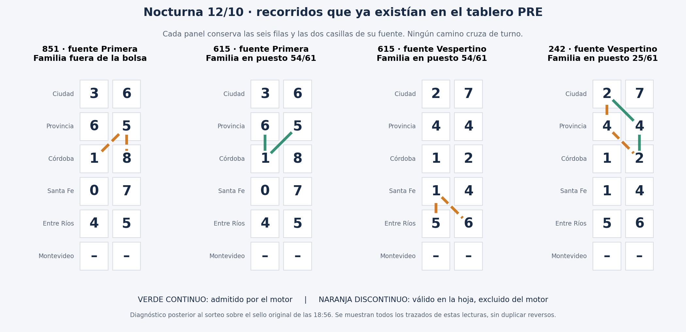

# VT3: diagnóstico de la Nocturna del 12/10/2026

13/10/2026. Por indicación del usuario, se suspende la línea VT4 y se vuelve a selección/cobertura VT3. Este estudio es un diagnóstico POST de un PRE genuinamente sellado antes del sorteo; no cambia sus candidatos ni su resultado prospectivo. No modificar producción a partir de este caso.

## Evidencia y reproducción

Se recuperó el artefacto original `11775746874` de [Actions 38313639450](https://github.com/y0t3/Modelo-Papa/actions/runs/38313639450). `NOCTURNA_PRE_SELLADO.json` tiene fecha de sello `2026-10-12T21:56:11.783Z` (18:56:11 Argentina), commit `9820e76eb599a81f15099b4ae61479a134acf152`, todas las columnas PRE y rankings completos. Se conserva aquí el archivo extraído sin alterarlo.

La reconstrucción usa las columnas exactas del sello y las hojas D−1 operativa (10/10 con base 09/10) y D−7 (05/10 con base 03/10) de la base histórica respaldada. Reproduce **exactamente todos los campos de las bolsas/rankings VT2, VT3 y VT4 publicados y las 85 raíces**, no sólo el Top10. El motor en el commit del sello tiene el mismo blob `1fb07419ef386cf2899f8c36b71b1f7317cef946` que el motor auditado. No se descargaron datos actuales para reconstruir el PRE.

Script reproducible Node 24: `node scripts/auditar-vt3-nocturna-12oct.mjs`. Evidencia detallada en `auditorias/vt3-nocturna-12oct2026/DIAGNOSTICO_VT3.json`.

Figura reproducible con `python scripts/dibujar-vt3-nocturna.py`. Verde: recorrido aceptado; naranja discontinuo: recorrido físicamente válido excluido. La figura es diagnóstico POST; no sustituye la hoja original ni representa una propuesta anterior al sorteo.

## Aclaración 815 / 851

El usuario mencionó 815. El contraste anterior consigna Ciudad **9851**, cuya VT3 es **851**, familia `158/851`. Se estudian ambas sin sustituir silenciosamente una por otra. 815 pertenece a `518/815`: no son reversos entre sí. Ambas existen en el tablero sobre el mismo conjunto de tres celdas, con distinto orden de lectura. Ninguna entró en la bolsa del motor.

## Resumen de cobertura real y clasificación PRE

| Lectura | Familia | Formaciones físicas (sin duplicar reversos) | Aceptadas por motor | Posición sellada |
|---|---|---:|---:|---:|
| 815 | 518/815 | 1 en fuente Primera | 0 | Ausente |
| 851 | 158/851 | 1 en fuente Primera | 0 | Ausente |
| 615 | 516/615 | 2: Primera y Vespertino | 1: Primera | 54/61 |
| 242 | 242/242 | 2 en Vespertino | 1 | 25/61 |
| 290 | 092/290 | 0 | 0 | Ausente |
| 264 | 264/462 | 0 | 0 | Ausente |

La bolsa completa sí contenía dos familias ganadoras: 516/615 y 242/242. La tercera terminación ganadora físicamente presente, 851, quedó fuera incluso de la bolsa. El tablero contiene **172 familias reversibles VT3 físicamente posibles**; el motor admite **61**. Estos números no son probabilidades ni implican que las 172 deban entrar al Top.

## Recorridos exactos

Coordenadas `fila:columna` desde cero. Filas: Ciudad, Provincia, Córdoba, Santa Fe, Entre Ríos, Montevideo. Columnas 0/1: izquierda/derecha dentro de una única fuente; nunca se cruza de turno.

Fuente Primera del PRE: `36, 65, 18, 07, 45, --`.
- **851:** `2:1(8) → 1:1(5) → 2:0(1)`. Válido pero excluido.
- **815:** `2:1(8) → 2:0(1) → 1:1(5)`. Válido pero excluido.
- **615:** `1:0(6) → 2:0(1) → 1:1(5)`. Válido y admitido.

Fuente Vespertino del PRE: `27, 44, 12, 14, 56, --`.
- **615 adicional:** `4:1(6) → 3:0(1) → 4:0(5)`. Válido pero excluido.
- **242 admitido:** `0:0(2) → 1:1(4) → 2:1(2)`.
- **242 adicional:** `0:0(2) → 1:0(4) → 2:1(2)`. Válido pero excluido. Los dos sentidos de cada trazado palindrómico no constituyen bloques adicionales.

## Por qué no entraron todos los recorridos

El motor PRE no enumera libremente todas las ternas de la hoja. Primero traslada rígidamente geometrías de recorridos históricos ganadores D−1/D−7, dentro de su fuente. Luego agrega bifurcaciones sólo si conservan **la misma familia, la misma fuente y un borde completo** con una ruta trasladada. Una coincidencia de cifras o casillas sin cumplir ese filtro no alcanza.

- **851/815:** ninguna geometría histórica admisible en Primera se traslada con el orden de movimientos de estos caminos. Al no existir una ruta inicial trasladada de esas familias, tampoco puede activarse la ampliación por bifurcación de la misma familia. No es un simple problema de posición en el ranking.
- **615 de Primera:** procede de `3729`, Santa Fe, Matutino del 05/10, sobre fuente Primera: `1:0 → 2:0 → 1:1` leía 729 y ahora lee 615. Es una raíz D−7 auténtica. La segunda formación está en otra fuente, Vespertino: no puede heredar esta raíz sin violar la atribución por fuente. No tiene traslado propio aceptado en Vespertino.
- **242:** procede de `6215`, Santa Fe, Nocturno del 10/10, fuente Vespertino: `1:0 → 2:1 → 3:1` leía 215. Trasladado una fila arriba produce `0:0 → 1:1 → 2:1`, que lee 242. El recorrido alternativo cambia el casillero central; comparte los extremos con el admitido, pero **ninguno de sus dos bordes**. Por eso el filtro actual de bifurcación no lo incorpora.

Esto describe la selección PRE, no un fallo demostrado del marcado POST de la hoja. La hoja y `findPaths` sí permiten identificar los recorridos físicos válidos. Hay que mantener separados: existencia física, anclaje histórico aceptado y prioridad de selección. Completar un inventario físico no autoriza a inventarle raíces históricas a un camino.

## Por qué 615 y 242 quedaron tan abajo

El orden VT3 es lexicográfico: (1) tener bifurcación, (2) cantidad de bloques bifurcados, (3) raíces D−1, (4) raíces D−7, (5) fuentes, (6) bloques; al final, orden alfabético de la familia.

**Las 19 familias con bifurcaciones se colocan por delante de toda familia sin bifurcación**, aunque ésta tenga un traslado histórico real. No es una pequeña bonificación: es prioridad absoluta en la primera comparación. Los diez puestos seleccionados pertenecen a ese grupo.

- `242/242`: vector `[0,0,1,0,1,1]`. Tiene delante 19 por bifurcación, cuatro por mayor cantidad de bloques con los criterios anteriores empatados, y una por desempate alfabético. Queda 25.
- `516/615`: vector `[0,0,0,1,1,1]`. Tiene delante 19 por bifurcación, nueve por raíces D−1, seis por más raíces D−7 y 19 por desempate alfabético con el mismo vector. Queda 54. Su posición exacta no expresa una estimación calibrada de menor probabilidad.

615 pertenece a un empate de 27 familias (puestos 35–61); 242, a uno de cinco (24–28). El desempate alfabético sólo fija el puesto dentro de esos grupos: aun cambiándolo, no entrarían al Top10 con las prioridades anteriores intactas.

**Concentración:** nueve de las diez familias Top10 tienen recorridos en la fuente Nocturna anterior; dos de esas nueve también en Primera. La décima, `424/424`, está en Vespertino. `565/565` lidera con cinco bloques bifurcados, sin raíz D−7. La fuente repetitiva `35,65,55,26,75,26` ofrece muchas formaciones que el criterio premia. Esto explica cómo domina el Top, no prueba que otra fuente vaya a acertar.

## Conclusión y continuación VT3

Hay dos cuestiones distintas: **cobertura** (851 no ingresa; 615/242 pierden parte de sus formaciones físicas) y **ranking** (prioridad absoluta a bifurcaciones y luego D−1). Cambiar sólo el ranking jamás recuperaría 851 de esta bolsa.

Siguiente trabajo: auditar en los cortes históricos, para todas las familias y conservando negativos, el inventario completo de recorridos frente al subconjunto anclado, incluyendo alternativas de casillero central como 242 y familias sin traslado inicial como 851. Mantener etiquetas de procedencia; no presentar un camino nuevo como traslado histórico. Después contrastar por separado la prioridad absoluta de bifurcación, sin ajustar una regla para hacer ganar estas tres terminaciones. El resultado de esta Nocturna ya se conoce: cualquier regla inspirada aquí será exploratoria y necesitará fechas nuevas.

VT4 queda fuera del foco siguiente por indicación explícita del usuario. No se modificó el motor productivo ni el PRE sellado.
